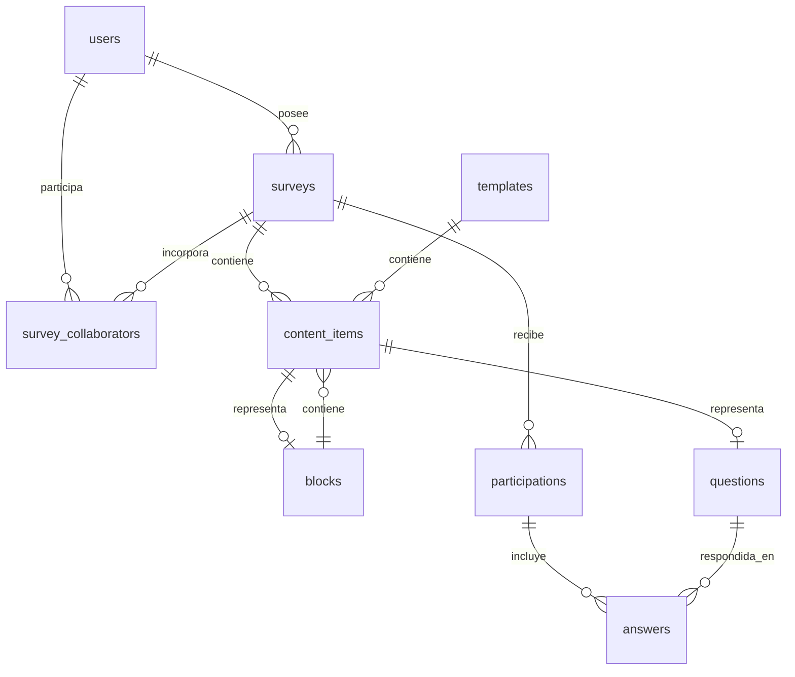

# Sistema y datos

FormQuid se divide en una interfaz web, una API y una base de datos PostgreSQL. La interfaz presenta los formularios y las páginas de gestión. La API aplica las reglas de negocio y guarda la información. El navegador se comunica con la API mediante peticiones HTTP a `/api/v1`.

```text
Navegador
   │
   ├── React, React Router y Vite
   │        │
   │        └── API REST de Spring Boot
   │                    ├── PostgreSQL y Flyway
   │                    ├── Almacenamiento de portadas
   │                    └── Servidor SMTP, si se activa el correo
```

## Interfaz

El código de `frontend/src` se organiza en tres partes principales:

- `app/routes` contiene las páginas y `app/router.jsx` define quién puede abrirlas.
- `components` reúne los elementos compartidos de la interfaz.
- `api` centraliza las peticiones al backend.

Vite sirve la interfaz durante el desarrollo y genera los archivos estáticos con `npm run build`.

El cliente de API incluye las cookies de sesión en sus peticiones. También obtiene el token CSRF y lo envía en las operaciones que modifican datos. La URL base puede configurarse con `VITE_API_BASE_URL`.

## Servidor

El backend está desarrollado con Java 21 y Spring Boot 4. En `backend/src/main/java/com/formquid` el código se organiza por funciones:

- `survey`, `content`, `question`, `block` y `template` construyen las encuestas y el catálogo.
- `participation` y `statistics` procesan las respuestas y los resultados.
- `collaboration`, `registration`, `elementrequest` y `notification` gestionan solicitudes y avisos.
- `auth`, `user` y `config` reúnen la autenticación, las cuentas y la configuración común.

Los controladores reciben las peticiones y los servicios comprueban permisos y reglas de negocio. Spring Data JPA gestiona la persistencia. Flyway aplica las migraciones SQL de `backend/src/main/resources/db/migration` al arrancar con los perfiles `dev` y `prod`.

## Recorridos principales

Una encuesta comienza como borrador. El editor incorpora textos, preguntas y bloques, o parte de una plantilla del catálogo. También puede previsualizar e importar un archivo ODT. Al abrir la encuesta se genera un código público y se aplican el modo de acceso y la visibilidad elegidos. El formulario valida las respuestas antes de registrar una participación. Los resultados individuales y las estadísticas se consultan desde el área de gestión.

La colaboración tiene permisos de lectura y edición. Las invitaciones, solicitudes de acceso y solicitudes de publicación se registran por separado. El propietario conserva el control de la publicación. Las notificaciones permiten seguir estas acciones.

## Seguridad y servicios auxiliares

La autenticación utiliza un JWT en una cookie `HttpOnly`. Spring Security controla el acceso a las rutas y el backend comprueba los permisos sobre cada recurso. Las contraseñas se almacenan mediante BCrypt. La recuperación de contraseña genera enlaces de un solo uso y necesita un servidor SMTP para enviarlos.

Las portadas se guardan fuera de la base de datos. Docker Compose monta un volumen para conservarlas. MailHog facilita la revisión del correo durante el desarrollo. PostgreSQL se configura como servicio externo a los archivos Compose del repositorio.

## Modelo de datos

El diseño relacional elaborado al comienzo del TFG sirvió para definir las entidades principales. Durante el desarrollo se modificaron algunas decisiones. El esquema que utiliza la aplicación se obtiene de las migraciones de `backend/src/main/resources/db/migration`.

Las tablas actuales se pueden entender por grupos:

- **Cuentas.** `users` guarda las cuentas, `registration_requests` las solicitudes de alta y `password_reset_tokens` los enlaces de recuperación.
- **Encuestas.** `surveys` guarda el propietario, el estado, el acceso, la visibilidad y las etiquetas. `survey_collaborators`, `collaboration_requests` y `publication_requests` registran el trabajo compartido.
- **Contenido.** `templates`, `blocks` y `questions` permiten reutilizar elementos. `content_items` conserva su orden dentro de una encuesta, plantilla o bloque. `question_settings`, `question_options` y `matrix_rows` completan la configuración de las preguntas.
- **Respuestas.** `participations` pertenece a una encuesta y `answers` contiene sus respuestas. `answer_options` y `matrix_answer_values` guardan selecciones y valores de matriz.
- **Gestión.** `element_requests` almacena propuestas para el catálogo, `notifications` los avisos, `categories` las categorías y `superadmin_guard` la garantía de que exista un superadministrador.

Una encuesta pertenece a un usuario y puede tener colaboradores. Cada elemento de contenido pertenece a una encuesta, plantilla o bloque. Si representa una pregunta o un bloque, se enlaza con esa entidad. Un bloque contiene textos y preguntas. El servicio impide incluir un bloque dentro de otro. Las estadísticas se calculan a partir de las respuestas guardadas.

El siguiente esquema resume las relaciones principales. Las tablas de configuración se omiten para que el recorrido sea más fácil de seguir.



### Cambios respecto al diseño inicial

- Los identificadores internos principales son numéricos. La encuesta recibe además un código público de doce caracteres cuando se abre.
- Las etiquetas se guardan en un arreglo de `surveys` y se admiten hasta diez.
- Se pueden crear varios superadministradores. `superadmin_guard` impide que se elimine el último.
- Una participación puede asociarse a un usuario o al hash del identificador de una persona anónima. Hay índices únicos para evitar dos envíos de la misma identidad en una encuesta.
- El campo de género desapareció de usuarios y solicitudes. Se añadieron categorías gestionables y tokens de recuperación de contraseña.

Estos cambios figuran, entre otras, en las migraciones V8, V17, V19, V24, V28, V33 y V34. El diseño inicial ayuda a entender el punto de partida y las migraciones describen la base actual.
